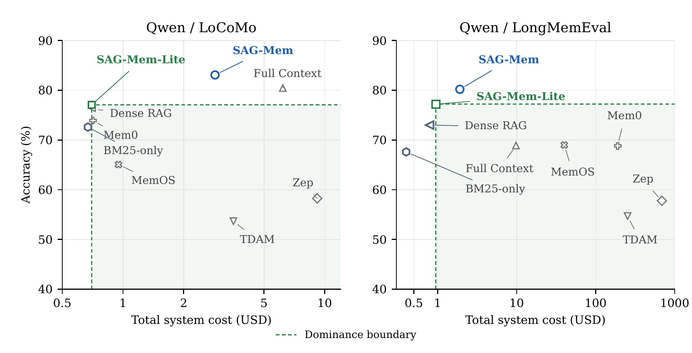
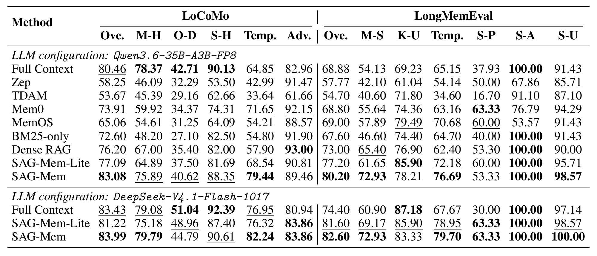

<p align="center">
  
</p>

<h1 align="center">SAG-Mem</h1>

<p align="center">
  <strong>English</strong> · <a href="README.zh-CN.md">简体中文</a>
</p>

<p align="center"><strong>Long-term conversational memory through evidence-guided retrieval.</strong></p>

<p align="center">
  Code and evaluation workflows for <em>SAG-Mem-1.0 Technical Report</em>.<br />
  Preserve complete dialogue, retrieve evidence across sessions, and clarify time before answering.
</p>

<p align="center"><strong>Dialogue → Chunks → Evidence → Answer</strong></p>

<p align="center">
  <a href="#benchmark-results">Paper results</a> · <a href="#quick-start">Quick start</a> · <a href="reproduction/README.md">Experiment guide</a> · <a href="https://github.com/Zleap-AI/SAG-Benchmark">SAG2 retrieval engine</a>
</p>

**Contents**

- **SAG-Mem**
  - [Benchmark Results](#benchmark-results)
  - [Method Overview](#method-overview)
  - [Quick Start](#quick-start)
  - [Datasets](#datasets)
  - [Retrieval Configuration](#retrieval-configuration)
  - [Outputs and Resume](#outputs-and-resume)
  - [Common Scripts](#common-scripts)
- **Code and Evaluation**
  - [Repository Layout](#repository-layout)
  - [Ablations and Evaluation](#ablations-and-evaluation)
  - [Indexing and Cost](#indexing-and-cost)
  - [Verification](#verification)

## Benchmark Results

The paper evaluates **SAG-Mem** and **SAG-Mem-Lite** on text-only **LoCoMo** and **LongMemEval-S**, with **1,986** and **500** questions. Both methods retrieve original dialogue and use a Reader to answer and a Judge to score the answer.





## Method Overview

| Stage | SAG-Mem | SAG-Mem-Lite |
|---|---|---|
| Build | Store complete messages in session-local chunks | Store the same chunks and precompute embeddings |
| Initial retrieval | BM25 candidates | BM25 candidates |
| Candidate scoring | JEV evidence scores | Question–chunk cosine similarity |
| Expansion | Extract terms from selected evidence; retrieve further chunks | Use the same lexical expansion with a larger search budget |
| Answer | Add source dates and relative-time annotations; pass Top-20 to the Reader | Use the same time rendering and Reader/Judge protocol |

1. **Preserve dialogue.** Pack up to three complete messages within each session around a soft 512-token target. An oversized message remains a complete chunk.
2. **Retrieve evidence.** Search the original text, score candidates, and select evidence for lexical expansion.
3. **Connect sessions.** Use terms from selected chunks to retrieve further evidence for the original question.
4. **Clarify time and answer.** Annotate supported relative-time expressions after retrieval, then generate and evaluate the answer.

SAG-Mem performs no model inference during indexing. Lite adds chunk embeddings at build time and one question embedding per query. Both methods preserve the source text passed to the Reader.

## Quick Start

Use **Python 3.11+** on Linux or macOS. Run the commands below from the repository root in Bash.

### 1. Install

```bash
python3 -m venv .venv
source .venv/bin/activate
python -m pip install -r reproduction/requirements.txt
```

The retrieval package is pinned to `zleap-sag2==0.4.0`. Reader, Judge, JEV and embedding inference use configured API endpoints.

SAG-Mem keeps the full JEV scoring rule in shared state and sends a short rule reference for each candidate. This reduces repeated input while preserving the complete passages and scoring criteria.

### 2. Configure Models

Create the configuration while preserving an existing file:

```bash
test -f .env || cp reproduction/.env.example .env
```

Set `OPENAI_API_KEY` in the repository-root `.env`. The template uses OpenRouter, Qwen3.6-35B-A3B-FP8 for Reader/Judge, and JEV for SAG-Mem. Lite shares the Reader/Judge configuration and uses the selected embedding profile.

| Variable | Purpose |
|---|---|
| `OPENAI_API_KEY`, `OPENAI_BASE_URL` | Shared API credentials and endpoint |
| `SEARCH_LLM_API_KEY`, `SEARCH_LLM_BASE_URL`, `SEARCH_LLM_MODEL` | Reader |
| `JUDGE_LLM_API_KEY`, `JUDGE_LLM_BASE_URL`, `JUDGE_LLM_MODEL` | Judge |
| `OPENAI_EXTRA_BODY` | Shared provider routing and reasoning options |
| `JEV_API_KEY`, `JEV_BASE_URL`, `JEV_MODEL` | SAG-Mem evidence scoring |
| `SAG2_EMBEDDING_API_KEY`, `SAG2_EMBEDDING_BASE_URL` | Optional embedding endpoint overrides |

Reader/Judge model names come from `.env`. `--model qwen` and `--model deepseek` select the experiment group and default output directory; configure the corresponding model and provider in `.env` before running either group.

### 3. Prepare Data

Download the two datasets to the paths used by the runner:

```bash
mkdir -p reproduction/data

test -f reproduction/data/locomo10.json || \
  curl -fL https://raw.githubusercontent.com/snap-research/locomo/main/data/locomo10.json \
  -o reproduction/data/locomo10.json

test -f reproduction/data/longmemeval_s_cleaned.json || \
  curl -fL https://huggingface.co/datasets/xiaowu0162/longmemeval-cleaned/resolve/main/longmemeval_s_cleaned.json \
  -o reproduction/data/longmemeval_s_cleaned.json
```

Check inputs and chunking before calling a model:

```bash
python reproduction/run.py --method sag-mem --dataset locomo --limit 2 --preflight
python reproduction/run.py --method sag-mem-lite --dataset longmemeval --limit 2 --preflight
```

`--preflight` requires no API key and makes no model requests. `--data-path` selects an existing dataset file.

### 4. Run Two Questions First

These commands make model requests. Use a separate output for each run:

```bash
python reproduction/run.py --method sag-mem --dataset locomo --limit 2 \
  --output reproduction/experiments/main/smoke/locomo/run.jsonl

python reproduction/run.py --method sag-mem-lite --dataset locomo --limit 2 \
  --embedding-profile qwen3 \
  --output reproduction/experiments/lite/smoke/locomo/run.jsonl
```

### 5. Run the Full Benchmarks

With the Qwen Reader/Judge configuration in `.env`:

```bash
for dataset in locomo longmemeval; do
  python reproduction/run.py --method sag-mem --dataset "$dataset" \
    --model qwen --build-concurrency 2 --resume
  python reproduction/run.py --method sag-mem-lite --dataset "$dataset" \
    --model qwen --embedding-profile qwen3 --build-concurrency 2 --resume
done
```

`--limit` controls the number of questions. `--concurrency` controls parallel questions; `--build-concurrency` controls parallel history builds.

## Datasets

| Dataset | Questions | Content | Default file |
|---|---:|---|---|
| LoCoMo | 1,986 | Text-only dialogue; image captions excluded | `reproduction/data/locomo10.json` |
| LongMemEval-S | 500 | Multi-session dialogue with question and session dates | `reproduction/data/longmemeval_s_cleaned.json` |

Source data: [LoCoMo](https://github.com/snap-research/locomo) and [LongMemEval cleaned data](https://huggingface.co/datasets/xiaowu0162/longmemeval-cleaned).

<details>
<summary>Dataset SHA-256 checksums</summary>

| File | SHA-256 |
|---|---|
| `locomo10.json` | `79fa87e90f04081343b8c8debecb80a9a6842b76a7aa537dc9fdf651ea698ff4` |
| `longmemeval_s_cleaned.json` | `d6f21ea9d60a0d56f34a05b609c79c88a451d2ae03597821ea3d5a9678c3a442` |

</details>

## Retrieval Configuration

| Argument | SAG-Mem default | Lite default | Purpose |
|---|---:|---:|---|
| `--candidate-k` | 50 | 100 | New candidates per lexical search |
| `--max-hops` | 1 | 2 | Expansion rounds after initial retrieval |
| `--top-k` | 20 | 20 | Chunks passed to the Reader |
| `--concurrency` | 20 | 20 | Parallel questions |
| `--build-concurrency` | 4 | 4 | Parallel history builds |
| `--model` | `qwen` | `qwen` | Experiment group and output layout |
| `--embedding-profile` | — | `qwen3` | Lite encoder: `qwen3` or `bge` |
| `--embedding-overflow` | — | `error` | Encoder-window rule: `error` or BGE `prefix` |
| `--messages-per-chunk` | 3 | 3 | Maximum messages per chunk; 0 means no cap |

Both methods use 10 expansion seeds and up to 20 expansion terms. The chunk target is 512 BGE tokens; it does not split a source message.

Both methods default to at most three complete messages per chunk. The 512-token soft target still applies. Use `--messages-per-chunk 0` to remove the message-count cap. The selected cap is recorded in the index configuration; changing it creates a separate index.

Lite embedding profiles:

| Profile | Model | Dimensions | Input window |
|---|---|---:|---:|
| `qwen3` | `qwen/qwen3-embedding-8b` | 4,096 | 32,768 tokens |
| `bge` | `BAAI/bge-large-en-v1.5` | 1,024 | 512 tokens |

For BGE, `prefix` encodes the longest original prefix that fits the encoder window. The stored chunk and Reader input remain complete. Set `EMBEDDING_MODEL_NAME` if the endpoint uses another BGE model identifier.

```bash
python reproduction/run.py --method sag-mem-lite --dataset locomo \
  --embedding-profile bge --embedding-overflow prefix \
  --output reproduction/experiments/lite/bge/locomo/run.jsonl
```

## Outputs and Resume

Default paths are relative to the repository root:

```text
reproduction/
├── experiments/main/results/<dataset>/full/
│   ├── run.jsonl
│   ├── run.jsonl.manifest.json
│   ├── run.summary.json
│   └── requests.jsonl
├── experiments/lite/results/<dataset>/qwen/
│   └── run.jsonl + manifest, summary and request log
└── indexes/
    ├── <namespace>/<build_id>/
    │   ├── build.json
    │   ├── sources.json
    │   └── sag2.sqlite
    └── cache/
```

| File | Content |
|---|---|
| `run.jsonl` | Answers, grades, evidence, timing and usage per question |
| `run.jsonl.manifest.json` | Dataset, code, model and configuration identity |
| `run.summary.json` | Aggregate accuracy, completed questions and errors |
| `requests.jsonl` | Recorded API requests, usage and returned costs |
| `sources.json` | Complete source chunks and message provenance |

Use `--resume` with the same configuration to skip completed questions and retry failed ones. Set `--output`, `--index-root` and `--cache-root` for separate experiments. Keep manifests beside their result files.

### Replay with Another Reader/Judge

To evaluate DeepSeek on the saved evidence, update these fields in `.env`:

```dotenv
SEARCH_LLM_MODEL=deepseek/deepseek-v4.1-flash-1017
JUDGE_LLM_MODEL=deepseek/deepseek-v4.1-flash-1017
OPENAI_EXTRA_BODY='{"reasoning":{"enabled":false},"provider":{"only":["DeepSeek"],"allow_fallbacks":false}}'
```

Then replay the completed Qwen runs:

```bash
for dataset in locomo longmemeval; do
  python reproduction/run.py --method sag-mem --dataset "$dataset" --model deepseek --resume \
    --replay-from "reproduction/experiments/main/results/$dataset/full/run.jsonl"
  python reproduction/run.py --method sag-mem-lite --dataset "$dataset" --model deepseek --resume \
    --replay-from "reproduction/experiments/lite/results/$dataset/qwen/run.jsonl"
done
```

Replay verifies the saved data and evidence, then calls only Reader and Judge. Retrieval and embeddings are reused.

## Common Scripts

| Entry point | Purpose |
|---|---|
| `reproduction/run.py` | SAG-Mem / Lite runs, preflight, resume and replay |
| `reproduction/experiments/ablations/prepare.py` | Prepare time-rendering and no-expansion controls |
| `reproduction/experiments/ablations/run.py` | Evaluate prepared controls |
| `reproduction/experiments/ablations/verify.py` | Verify prepared ablation inputs |
| `reproduction/experiments/latency/run.py` | Serial paired latency over prepared indexes |
| `reproduction/experiments/lite/verify.py` | Audit saved runs and source evidence |
| `reproduction/experiments/lite/canonical_summary.py` | Qwen3 Lite token and cost accounting |
| `reproduction/analysis/aggregate.py` | Aggregate identified runs and paper comparison tables |

Run a script with `--help` to inspect its arguments. Experiment-module commands use `python -m reproduction.experiments.…`; see the examples below.

## Repository Layout

```text
README.md / README.zh-CN.md    # Project overview and running instructions
assets/                       # README assets
reproduction/
├── run.py                    # Unified method entry point
├── requirements.txt          # Paper runtime dependencies
├── .env.example              # API configuration template
├── experiments/
│   ├── shared/               # Chunking, model profiles and request accounting
│   ├── main/                 # SAG-Mem adapter
│   ├── lite/                 # Lite adapter, replay and verification
│   ├── ablations/            # Time-rendering and expansion controls
│   └── latency/              # Serial latency measurement
├── analysis/                 # Result aggregation and reference data
└── tests/                    # Paper workflow tests
src/
├── backends/                  # Retrieval implementations and source mapping
├── data/                      # Dataset loading
└── harness/                   # Reader, Judge and evaluation contracts
```

Datasets, credentials, result records, indexes and caches are local runtime files. Keep each experiment's configuration and manifest with its outputs.

## Ablations and Evaluation

The [ablation guide](reproduction/experiments/ablations/README.md) covers raw dates, normalized dates, relative-time annotations and no-expansion controls. Prepare controls from a completed main run without model requests:

```bash
python -m reproduction.experiments.ablations.prepare \
  --source reproduction/experiments/main/results/locomo/full/run.jsonl \
  --method sag-mem --dataset locomo --scope temporal \
  --output reproduction/experiments/ablations/prepared/sag-mem/locomo/temporal
```

With Qwen configured in `.env`, evaluate the controls and measure serial latency:

```bash
python -m reproduction.experiments.ablations.run --data-root reproduction/data
python -m reproduction.experiments.latency.run --data-root reproduction/data \
  --main-index-root reproduction/indexes --lite-index-root reproduction/indexes \
  --lite-cache-root reproduction/indexes/cache
```

These commands call model APIs. The [latency guide](reproduction/experiments/latency/README.md) describes the fixed selection: 100 LoCoMo questions and 50 LongMemEval questions, evaluated serially on warm indexes.

## Indexing and Cost

SAG-Mem builds a lexical index without model requests. Lite also stores chunk vectors. Indexes and document embeddings are reused when their data and configuration identities match.

For a completed Qwen3 Lite run:

```bash
python -m reproduction.experiments.lite.canonical_summary \
  reproduction/experiments/lite/results/locomo/qwen/run.jsonl
```

The output uses the recorded encoder to count tokens and measure local index size. System cost includes one construction per history, per-question retrieval and Reader generation; Judge cost is separate. Recorded prompt-cache tokens use the fixed cache rate; missing cache metadata uses the regular input rate. The price table includes the Qwen3 embedding profile by default. Newly billed API requests are reported separately. Latency excludes indexing and Judge calls; it measures retrieval, time rendering and Reader generation.

After completing both datasets and both Reader/Judge groups:

```bash
python reproduction/analysis/aggregate.py --require-all --data-root reproduction/data
```

This writes `reproduction/analysis/final_results.json` and `question_metrics.json`. It checks data identity, question coverage and the configured evaluation protocol before aggregation.

## Verification

The paper workflow tests run with the dependencies installed above:

```bash
python -m pytest -q reproduction
```

They exercise both methods on both dataset formats, index construction, retrieval, Reader/Judge calls with test responses, cache reuse, replay, ablations and serial latency. External model requests are blocked in tests; the tokenizer is cached on first use.

Audit a completed run without making model requests:

```bash
python -m reproduction.experiments.lite.verify \
  reproduction/experiments/main/results/locomo/full/run.jsonl
```

The audit checks coverage, manifests, evidence hashes, saved source text and Reader context. The detailed [experiment guide](reproduction/README.md) describes the same workflows.
