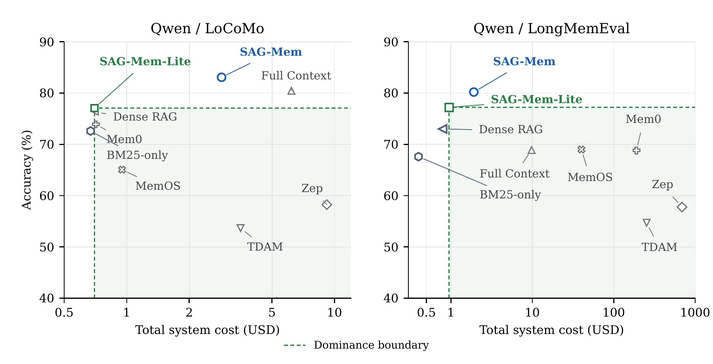
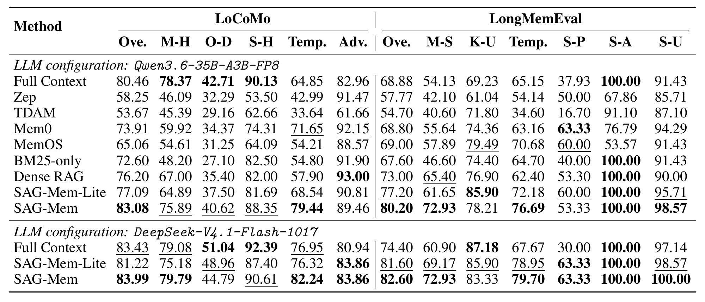

<p align="center">
  
</p>

<h1 align="center">SAG-Mem</h1>

<p align="center">
  <a href="README.md">English</a> · <strong>简体中文</strong>
</p>

<p align="center"><strong>面向长期对话记忆的证据引导检索。</strong></p>

<p align="center">
  《SAG-Mem-1.0 Technical Report》的代码与评测流程。<br />
  保留完整对话，在会话之间检索证据，并在回答前明确时间信息。
</p>

<p align="center"><strong>对话 → 分块 → 证据 → 回答</strong></p>

<p align="center">
  <a href="#论文结果">论文结果</a> · <a href="#快速开始">快速开始</a> · <a href="reproduction/README.md">实验指南</a> · <a href="https://github.com/Zleap-AI/SAG-Benchmark">SAG2 检索引擎</a>
</p>

**目录**

- **SAG-Mem**
  - [论文结果](#论文结果)
  - [方法流程](#方法流程)
  - [快速开始](#快速开始)
  - [数据集](#数据集)
  - [检索配置与参数](#检索配置与参数)
  - [输出与恢复](#输出与恢复)
  - [常用脚本](#常用脚本)
- **代码与评测**
  - [代码目录](#代码目录)
  - [消融与评测](#消融与评测)
  - [索引与费用](#索引与费用)
  - [验证](#验证)

## 论文结果

论文在纯文本 **LoCoMo** 和 **LongMemEval-S** 上评测 **SAG-Mem** 与 **SAG-Mem-Lite**，分别包含 **1,986** 题和 **500** 题。两种方法均检索原始对话，由 Reader 生成回答，再由 Judge 评分。





## 方法流程

| 阶段 | SAG-Mem | SAG-Mem-Lite |
|---|---|---|
| 构建 | 按会话保存完整消息分块 | 保存相同分块并预计算嵌入向量 |
| 初始检索 | BM25 候选 | BM25 候选 |
| 候选评分 | JEV 证据评分 | 问题与分块的余弦相似度 |
| 扩展 | 从选中证据提取词项，检索更多分块 | 使用相同的词法扩展和更大的检索预算 |
| 回答 | 补充来源日期与相对时间标注，将 Top-20 交给 Reader | 使用相同的时间呈现与 Reader/Judge 协议 |

1. **保留对话。** 在同一会话内合并最多三条完整消息，以 512 token 为软目标。单条超长消息保留为完整分块。
2. **检索证据。** 检索原文，对候选评分，选取用于词法扩展的证据。
3. **关联会话。** 使用已选分块中的词项，查找回答原始问题所需的其他证据。
4. **明确时间并回答。** 检索完成后标注支持的相对时间表达，再生成和评估回答。

SAG-Mem 建索引时无需模型推理。Lite 在构建时计算分块向量，每次查询计算一次问题向量。两种方法均保留交给 Reader 的来源原文。

## 快速开始

使用 **Python 3.11+**，支持 Linux 和 macOS。以下 Bash 命令均在仓库根目录执行。

### 1. 安装

```bash
python3 -m venv .venv
source .venv/bin/activate
python -m pip install -r reproduction/requirements.txt
```

检索包固定为 `zleap-sag2==0.4.0`。Reader、Judge、JEV 和嵌入推理通过配置的 API 服务完成。

SAG-Mem 将完整的 JEV 评分规则放在共享上下文中，每个候选只发送简短的规则引用，减少重复输入。候选原文和评分标准均完整保留。

### 2. 配置模型

首次创建配置文件，保留已有配置：

```bash
test -f .env || cp reproduction/.env.example .env
```

在仓库根目录 `.env` 中填写 `OPENAI_API_KEY`。模板使用 OpenRouter，Reader/Judge 为 Qwen3.6-35B-A3B-FP8，SAG-Mem 使用 JEV 评分；Lite 共用 Reader/Judge 配置，并使用选定的嵌入配置。

| 变量 | 用途 |
|---|---|
| `OPENAI_API_KEY`、`OPENAI_BASE_URL` | 共用 API 密钥与服务地址 |
| `SEARCH_LLM_API_KEY`、`SEARCH_LLM_BASE_URL`、`SEARCH_LLM_MODEL` | Reader |
| `JUDGE_LLM_API_KEY`、`JUDGE_LLM_BASE_URL`、`JUDGE_LLM_MODEL` | Judge |
| `OPENAI_EXTRA_BODY` | 共用供应商路由与推理选项 |
| `JEV_API_KEY`、`JEV_BASE_URL`、`JEV_MODEL` | SAG-Mem 证据评分 |
| `SAG2_EMBEDDING_API_KEY`、`SAG2_EMBEDDING_BASE_URL` | 可选的嵌入服务配置 |

Reader/Judge 的实际模型名称从 `.env` 读取。`--model qwen` 和 `--model deepseek` 选择实验分组及默认输出目录；运行前请在 `.env` 中配置对应模型和供应商。

### 3. 准备数据

将两个数据集下载到入口使用的路径：

```bash
mkdir -p reproduction/data

test -f reproduction/data/locomo10.json || \
  curl -fL https://raw.githubusercontent.com/snap-research/locomo/main/data/locomo10.json \
  -o reproduction/data/locomo10.json

test -f reproduction/data/longmemeval_s_cleaned.json || \
  curl -fL https://huggingface.co/datasets/xiaowu0162/longmemeval-cleaned/resolve/main/longmemeval_s_cleaned.json \
  -o reproduction/data/longmemeval_s_cleaned.json
```

调用模型前，先检查输入和分块：

```bash
python reproduction/run.py --method sag-mem --dataset locomo --limit 2 --preflight
python reproduction/run.py --method sag-mem-lite --dataset longmemeval --limit 2 --preflight
```

`--preflight` 无需 API 密钥，不调用模型。已有数据可通过 `--data-path` 指定。

### 4. 先运行两题

以下命令会调用模型。每次实验使用独立输出：

```bash
python reproduction/run.py --method sag-mem --dataset locomo --limit 2 \
  --output reproduction/experiments/main/smoke/locomo/run.jsonl

python reproduction/run.py --method sag-mem-lite --dataset locomo --limit 2 \
  --embedding-profile qwen3 \
  --output reproduction/experiments/lite/smoke/locomo/run.jsonl
```

### 5. 运行完整评测

在 `.env` 中配置 Qwen Reader/Judge 后：

```bash
for dataset in locomo longmemeval; do
  python reproduction/run.py --method sag-mem --dataset "$dataset" \
    --model qwen --build-concurrency 2 --resume
  python reproduction/run.py --method sag-mem-lite --dataset "$dataset" \
    --model qwen --embedding-profile qwen3 --build-concurrency 2 --resume
done
```

`--limit` 控制问题数量，`--concurrency` 控制并行问题数，`--build-concurrency` 控制并行构建的历史数量。

## 数据集

| 数据集 | 问题数 | 内容 | 默认文件 |
|---|---:|---|---|
| LoCoMo | 1,986 | 纯文本对话，不包含图像描述 | `reproduction/data/locomo10.json` |
| LongMemEval-S | 500 | 多会话对话及问题、会话日期 | `reproduction/data/longmemeval_s_cleaned.json` |

数据来源：[LoCoMo](https://github.com/snap-research/locomo) 与 [LongMemEval cleaned data](https://huggingface.co/datasets/xiaowu0162/longmemeval-cleaned)。

<details>
<summary>数据文件 SHA-256</summary>

| 文件 | SHA-256 |
|---|---|
| `locomo10.json` | `79fa87e90f04081343b8c8debecb80a9a6842b76a7aa537dc9fdf651ea698ff4` |
| `longmemeval_s_cleaned.json` | `d6f21ea9d60a0d56f34a05b609c79c88a451d2ae03597821ea3d5a9678c3a442` |

</details>

## 检索配置与参数

| 参数 | SAG-Mem 默认值 | Lite 默认值 | 用途 |
|---|---:|---:|---|
| `--candidate-k` | 50 | 100 | 每次词法检索的新候选数 |
| `--max-hops` | 1 | 2 | 初始检索后的扩展轮数 |
| `--top-k` | 20 | 20 | 交给 Reader 的分块数 |
| `--concurrency` | 20 | 20 | 并行问题数 |
| `--build-concurrency` | 4 | 4 | 并行构建历史数 |
| `--model` | `qwen` | `qwen` | 实验分组与输出目录 |
| `--embedding-profile` | — | `qwen3` | Lite 编码器：`qwen3` 或 `bge` |
| `--embedding-overflow` | — | `error` | 编码窗口规则：`error` 或 BGE 的 `prefix` |
| `--messages-per-chunk` | 3 | 3 | 每个分块的消息数上限；0 表示无上限 |

两种方法均选择 10 个扩展起点，最多使用 20 个扩展词项。分块以 512 BGE token 为软目标，不切分来源消息。

两种方法默认每个分块最多三条完整消息，同时保留 512 token 软目标。使用 `--messages-per-chunk 0` 可取消消息数限制。消息数上限会写入索引配置；修改上限后会使用独立索引。

Lite 支持以下嵌入配置：

| 配置 | 模型 | 维度 | 输入窗口 |
|---|---|---:|---:|
| `qwen3` | `qwen/qwen3-embedding-8b` | 4,096 | 32,768 token |
| `bge` | `BAAI/bge-large-en-v1.5` | 1,024 | 512 token |

使用 BGE 时，`prefix` 编码能放入窗口的最长原文前缀，保存的分块和 Reader 输入保持完整。服务端模型名称不同时，可设置 `EMBEDDING_MODEL_NAME`。

```bash
python reproduction/run.py --method sag-mem-lite --dataset locomo \
  --embedding-profile bge --embedding-overflow prefix \
  --output reproduction/experiments/lite/bge/locomo/run.jsonl
```

## 输出与恢复

默认路径均相对于仓库根目录：

```text
reproduction/
├── experiments/main/results/<dataset>/full/
│   ├── run.jsonl
│   ├── run.jsonl.manifest.json
│   ├── run.summary.json
│   └── requests.jsonl
├── experiments/lite/results/<dataset>/qwen/
│   └── run.jsonl + manifest、汇总与请求日志
└── indexes/
    ├── <namespace>/<build_id>/
    │   ├── build.json
    │   ├── sources.json
    │   └── sag2.sqlite
    └── cache/
```

| 文件 | 内容 |
|---|---|
| `run.jsonl` | 逐题答案、评分、证据、耗时与用量 |
| `run.jsonl.manifest.json` | 数据、代码、模型与配置标识 |
| `run.summary.json` | 总体准确率、完成题数与错误数 |
| `requests.jsonl` | API 请求记录、用量与返回费用 |
| `sources.json` | 完整来源分块与消息出处 |

使用相同配置添加 `--resume`，跳过已完成问题并重试失败问题。不同实验可指定独立的 `--output`、`--index-root` 和 `--cache-root`。结果文件与对应 manifest 应一同保留。

### 更换 Reader/Judge 重放

在已有证据上评测 DeepSeek，先修改 `.env`：

```dotenv
SEARCH_LLM_MODEL=deepseek/deepseek-v4.1-flash-1017
JUDGE_LLM_MODEL=deepseek/deepseek-v4.1-flash-1017
OPENAI_EXTRA_BODY='{"reasoning":{"enabled":false},"provider":{"only":["DeepSeek"],"allow_fallbacks":false}}'
```

然后重放已完成的 Qwen 结果：

```bash
for dataset in locomo longmemeval; do
  python reproduction/run.py --method sag-mem --dataset "$dataset" --model deepseek --resume \
    --replay-from "reproduction/experiments/main/results/$dataset/full/run.jsonl"
  python reproduction/run.py --method sag-mem-lite --dataset "$dataset" --model deepseek --resume \
    --replay-from "reproduction/experiments/lite/results/$dataset/qwen/run.jsonl"
done
```

重放先校验数据和保存的证据，再调用 Reader 与 Judge，复用检索和嵌入结果。

## 常用脚本

| 入口 | 用途 |
|---|---|
| `reproduction/run.py` | SAG-Mem / Lite 运行、预检查、恢复与重放 |
| `reproduction/experiments/ablations/prepare.py` | 准备时间呈现与无扩展控制 |
| `reproduction/experiments/ablations/run.py` | 评测已准备的控制条件 |
| `reproduction/experiments/ablations/verify.py` | 校验消融输入 |
| `reproduction/experiments/latency/run.py` | 在预建索引上测量串行配对延迟 |
| `reproduction/experiments/lite/verify.py` | 核验结果与来源证据 |
| `reproduction/experiments/lite/canonical_summary.py` | Qwen3 Lite 的 token 与费用统计 |
| `reproduction/analysis/aggregate.py` | 汇总有完整标识的运行和论文对比表 |

使用 `--help` 查看参数。实验模块通过 `python -m reproduction.experiments.…` 调用，示例见下文。

## 代码目录

```text
README.md / README.zh-CN.md    # 项目介绍与运行说明
assets/                       # README 资源
reproduction/
├── run.py                    # 统一方法入口
├── requirements.txt          # 论文运行依赖
├── .env.example              # API 配置模板
├── experiments/
│   ├── shared/               # 分块、模型配置与请求统计
│   ├── main/                 # SAG-Mem 适配器
│   ├── lite/                 # Lite 适配器、重放与核验
│   ├── ablations/            # 时间呈现与扩展控制
│   └── latency/              # 串行延迟测量
├── analysis/                 # 结果汇总与参考数据
└── tests/                    # 论文流程测试
src/
├── backends/                  # 检索实现与来源映射
├── data/                      # 数据加载
└── harness/                   # Reader、Judge 与评测协议
```

数据集、密钥、逐题结果、索引和缓存均为本地运行文件。请将每次实验的配置、manifest 与输出一同保存。

## 消融与评测

[消融指南](reproduction/experiments/ablations/README.md)涵盖原始日期、规范日期、相对时间标注和无扩展控制。从已完成的主实验准备控制条件，无需调用模型：

```bash
python -m reproduction.experiments.ablations.prepare \
  --source reproduction/experiments/main/results/locomo/full/run.jsonl \
  --method sag-mem --dataset locomo --scope temporal \
  --output reproduction/experiments/ablations/prepared/sag-mem/locomo/temporal
```

在 `.env` 中配置 Qwen 后，评测控制条件并测量串行延迟：

```bash
python -m reproduction.experiments.ablations.run --data-root reproduction/data
python -m reproduction.experiments.latency.run --data-root reproduction/data \
  --main-index-root reproduction/indexes --lite-index-root reproduction/indexes \
  --lite-cache-root reproduction/indexes/cache
```

这些命令会调用模型 API。[延迟指南](reproduction/experiments/latency/README.md)说明了固定选题方式：LoCoMo 100 题、LongMemEval 50 题，在已构建索引上逐题执行。

## 索引与费用

SAG-Mem 构建词法索引时不调用模型，Lite 额外保存分块向量。数据和配置标识一致时，索引与文档向量可复用。

对已完成的 Qwen3 Lite 运行统计费用：

```bash
python -m reproduction.experiments.lite.canonical_summary \
  reproduction/experiments/lite/results/locomo/qwen/run.jsonl
```

输出按运行记录中的编码器统计 token 数及本地索引大小。系统成本包含一次构建、逐题检索和 Reader，Judge 费用单列；输入缓存按记录中的缓存用量和固定缓存单价计算，缺少缓存记录时使用普通输入单价。价格表默认包含 Qwen3 嵌入配置。本次新增 API 费用另行统计。延迟不包含建索引和 Judge，测量检索、时间呈现及 Reader 生成。

完成两个数据集和两组 Reader/Judge 运行后汇总：

```bash
python reproduction/analysis/aggregate.py --require-all --data-root reproduction/data
```

输出为 `reproduction/analysis/final_results.json` 与 `question_metrics.json`，汇总前校验数据标识、问题覆盖和评测协议。

## 验证

安装上述依赖后，运行论文流程测试：

```bash
python -m pytest -q reproduction
```

测试覆盖两种方法与两个数据格式的索引构建、检索、Reader/Judge 测试响应、缓存复用、重放、消融和串行延迟。测试阻止外部模型请求，首次使用时缓存分词器。

核验已完成的运行，无需调用模型：

```bash
python -m reproduction.experiments.lite.verify \
  reproduction/experiments/main/results/locomo/full/run.jsonl
```

核验内容包括问题覆盖、manifest、证据哈希、保存的原文与 Reader 上下文。详细操作见[实验指南](reproduction/README.md)。
